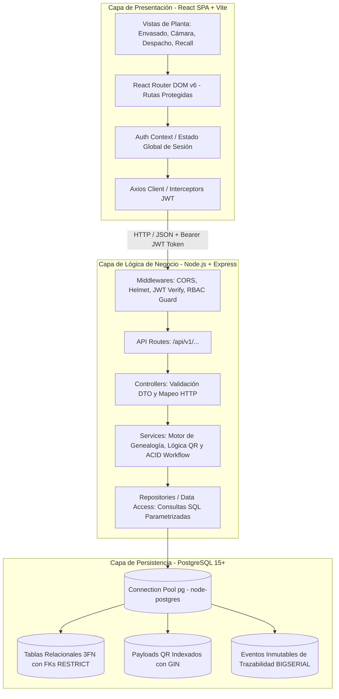
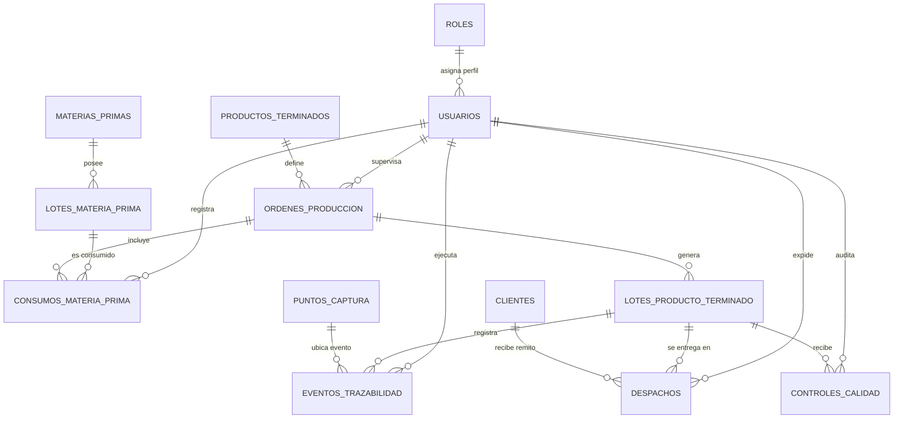

# ARQUITECTURA DE SOFTWARE, MODELO DE DATOS Y CONTRATOS REST — PP2

**Proyecto:** TrackFinal — Seguimiento de Producto Terminado  
**KIT:** AVZ-03 (Trazabilidad de Lote/Unidad — Genealogía Avanzada)  
**Empresa Piloto:** Lácteos San Antonio S.A.  
**Estudiante:** Joaquín Nicolás Cuello  
**Rol:** Arquitecto de Software Senior y DBA | Tutor Académico PP2  
**Fecha de Entrega:** Semana 3 (04/09/2026 - Regularizado)  
**Estado:** EVIDENCIADO  

---

## 1. Diagrama de Arquitectura de la Solución

El sistema **TrackFinal** adopta una arquitectura de software por capas (*Layered Architecture*) desacopladas, lo que asegura alta mantenibilidad, testeabilidad unitaria e independencia entre la interfaz de usuario, la lógica de negocio industrial y la capa de persistencia transaccional.



### Justificación de Componentes Tecnológicos:
1. **Frontend (React 18 + Vite):** Proporciona una experiencia de aplicación de una sola página (SPA) rápida y ligera, optimizada para responder en menos de 2 segundos en pantallas táctiles y navegadores de planta industrial.
2. **Backend (Node.js 22 LTS + Express 4.x):** Arquitectura orientada a servicios y repositorios sin ORMs pesados para mantener el control directo sobre las consultas SQL de genealogía y maximizar el rendimiento I/O.
3. **Persistencia (PostgreSQL 15+):** Motor relacional de grado empresarial con soporte transaccional estricto (ACID), almacenamiento indexado `JSONB` y funciones criptográficas nativas.

---

## 2. Modelo Relacional Normalizado (PostgreSQL)

### 2.1 Justificación Técnica del Motor: PostgreSQL vs. MySQL
Para el **KIT AVZ-03 (Trazabilidad y Genealogía Avanzada)**, la adopción de PostgreSQL ofrece ventajas críticas respecto a otros motores relacionales:
* **Almacenamiento Estructurado de Códigos QR (`JSONB`):** Permite almacenar el contenido completo y metadatos emitidos en la etiqueta física del producto terminado (`codigo_qr_payload`) como un documento JSON binario descompuesto e indexable mediante `GIN`. Esto posibilita buscar lotes por atributos dinámicos del QR sin penalizar tiempos de lectura.
* **Integridad Transaccional Estricta (ACID):** El registro de un nuevo lote PT implica descontar materia prima, crear el lote, almacenar el payload QR y generar el evento de trazabilidad inicial. PostgreSQL asegura aislamiento transaccional absoluto (`SERIALIZABLE` / `READ COMMITTED`).
* **Seguridad y Criptografía Integrada (`pgcrypto`):** Permite resolver el hashing de contraseñas de manera nativa mediante funciones robustas `crypt(..., gen_salt('bf', 10))`.
* **Escalabilidad de Auditoría:** Soporte nativo para secuencias de 64 bits (`BIGSERIAL`) en la tabla de `eventos_trazabilidad`, soportando millones de registros de planta sin desbordamiento.

---

### 2.2 Diccionario de Datos Normalizado (3FN)

El modelo cumple rigurosamente con la **Tercera Forma Normal (3FN)**: todos los atributos no clave dependen de manera directa e intransitiva de la clave primaria.



#### Descripción de Entidades:

| Tabla | Clave Primaria | Claves Foráneas (FK) | Propósito Operativo |
| :--- | :--- | :--- | :--- |
| **`roles`** | `id SERIAL` | Ninguna | Catálogo de perfiles RBAC (`ADMIN`, `SUPERVISOR`, `OPERARIO`, `AUDITOR`). |
| **`usuarios`** | `id SERIAL` | `rol_id -> roles(id)` | Registro de colaboradores con email único, legajo y contraseña cifrada con bcrypt. |
| **`materias_primas`** | `id SERIAL` | Ninguna | Catálogo de insumos básicos (leche cruda, fermentos, cuajos, fruta, azúcar). |
| **`lotes_materia_prima`** | `id SERIAL` | `materia_prima_id -> materias_primas(id)` | Lotes de tambos y proveedores con fecha de vencimiento y control de saldo de stock. |
| **`productos_terminados`** | `id SERIAL` | Ninguna | Catálogo maestro de quesos y yogures con SKU, días de vida útil y temperatura. |
| **`ordenes_produccion`** | `id SERIAL` | `producto_terminado_id -> productos_terminados(id)` | Órdenes de trabajo que consolidan la transformación de insumos en producto final. |
| **`consumos_materia_prima`** | `id SERIAL` | `orden_produccion_id -> ordenes_produccion(id)`, `lote_mp_id -> lotes_materia_prima(id)`, `operario_id -> usuarios(id)` | Nexo genealógico hacia atrás: insumos específicos consumidos por cada orden. |
| **`lotes_producto_terminado`** | `id SERIAL` | `orden_produccion_id -> ordenes_produccion(id)` | Lotes PT con código único (`LPT-YYYYMMDD-XXX`), estado, cámara y payload `JSONB`. |
| **`puntos_captura`** | `id SERIAL` | Ninguna | Lugares físicos de control de planta (Recepción, Tina, Envasado, Calidad, Cámara, Despacho). |
| **`eventos_trazabilidad`** | `id BIGSERIAL` | `lote_pt_id -> lotes_producto_terminado(id)`, `punto_captura_id -> puntos_captura(id)`, `usuario_id -> usuarios(id)` | Auditoría inmutable y cronológica de cada paso que recorre el lote físico. |
| **`controles_calidad`** | `id SERIAL` | `lote_pt_id -> lotes_producto_terminado(id)`, `usuario_id -> usuarios(id)` | Parámetros físico-químicos (pH, Acidez Dornic, grasa) y liberación del lote. |
| **`clientes`** | `id SERIAL` | Ninguna | Padrón de compradores y distribuidores habilitados (CUIT, razón social, dirección). |
| **`despachos`** | `id SERIAL` | `lote_pt_id -> lotes_producto_terminado(id)`, `cliente_id -> clientes(id)`, `usuario_id -> usuarios(id)` | Nexo legal de salida de fábrica con número de remito y cantidad despachada. |

---

### 2.3 Estrategia de Índices de Alto Rendimiento

Para asegurar tiempos de respuesta inferiores a 2 segundos (**RNF01**), el script `database/schema.sql` implementa los siguientes índices especializados:

1. **`idx_lote_pt_codigo` (B-Tree):** Indexa `lotes_producto_terminado(codigo_lote_pt)`. Permite búsqueda inmediata $O(\log N)$ ante el escaneo de una etiqueta QR en planta o ante el reclamo de un cliente.
2. **`idx_lotes_pt_qr_gin` (GIN):** Indexa `lotes_producto_terminado USING gin (codigo_qr_payload)`. Permite búsquedas directas por propiedades internas del payload JSON sin deserializar.
3. **`idx_lote_mp_codigo` (B-Tree):** Indexa `lotes_materia_prima(codigo_lote_mp)`. Acelera la búsqueda inicial de materias primas para procesos de *Recall*.
4. **`idx_eventos_lote` (Compuesto B-Tree):** Indexa `eventos_trazabilidad(lote_pt_id, timestamp_evento)`. Devuelve la línea temporal completa del lote ordenada cronológicamente sin necesidad de ordenamiento en memoria.
5. **`idx_consumos_op` (Compuesto B-Tree):** Indexa `consumos_materia_prima(orden_produccion_id, lote_mp_id)`. Une instantáneamente la orden de producción con sus materias primas.
6. **`idx_despachos_lote` y `idx_despachos_cliente` (B-Tree):** Resuelven en milisegundos las consultas cruzadas de recall hacia atrás y hacia adelante.

---

### 2.4 Consultas Nucleares de Genealogía (SQL Directo)

#### Consulta A: Trazabilidad Hacia Atrás (*Backward Traceability*)
Dado el código de un lote de producto terminado (`LPT-20260904-001`), obtener su árbol completo de origen:

```sql
SELECT 
    lpt.codigo_lote_pt,
    pt.nombre AS producto,
    lpt.fecha_elaboracion,
    lpt.fecha_vencimiento,
    lpt.estado AS estado_actual,
    op.numero_op,
    op.linea_produccion,
    mp.nombre AS materia_prima,
    lmp.codigo_lote_mp,
    lmp.proveedor,
    cmp.cantidad_consumida,
    u.nombre || ' ' || u.apellido AS operario_registro
FROM lotes_producto_terminado lpt
JOIN ordenes_produccion op ON lpt.orden_produccion_id = op.id
JOIN productos_terminados pt ON op.producto_terminado_id = pt.id
JOIN consumos_materia_prima cmp ON op.id = cmp.orden_produccion_id
JOIN lotes_materia_prima lmp ON cmp.lote_mp_id = lmp.id
JOIN materias_primas mp ON lmp.materia_prima_id = mp.id
JOIN usuarios u ON cmp.operario_id = u.id
WHERE lpt.codigo_lote_pt = 'LPT-20260904-001';
```

#### Consulta B: Trazabilidad Hacia Adelante (*Recall Logístico*)
Dada una materia prima sospechosa (`MP-LEC-2026-0819`), listar de inmediato todos los clientes que recibieron productos elaborados con ella:

```sql
SELECT 
    lmp.codigo_lote_mp,
    mp.nombre AS materia_prima,
    lpt.codigo_lote_pt,
    pt.nombre AS producto_terminado,
    d.numero_remito,
    d.fecha_despacho,
    d.cantidad_despachada,
    c.cuit AS cuit_cliente,
    c.razon_social AS cliente_destinatario,
    c.telefono AS contacto_cliente
FROM lotes_materia_prima lmp
JOIN materias_primas mp ON lmp.materia_prima_id = mp.id
JOIN consumos_materia_prima cmp ON lmp.id = cmp.lote_mp_id
JOIN ordenes_produccion op ON cmp.orden_produccion_id = op.id
JOIN lotes_producto_terminado lpt ON op.id = lpt.orden_produccion_id
JOIN productos_terminados pt ON op.producto_terminado_id = pt.id
JOIN despachos d ON lpt.id = d.lote_pt_id
JOIN clientes c ON d.cliente_id = c.id
WHERE lmp.codigo_lote_mp = 'MP-LEC-2026-0819';
```

---

## 3. Contratos Formales de API REST

Todos los endpoints se exponen bajo el prefijo unificado `/api/v1` y manejan payloads `application/json`. Las rutas privadas requieren cabecera `Authorization: Bearer <jwt_token>`.

### 3.1 Tabla Resumen de Endpoints

| Método | Endpoint | Rol Requerido | Descripción |
| :---: | :--- | :---: | :--- |
| `POST` | `/api/v1/auth/login` | Público | Autenticación y entrega de token JWT con rol. |
| `GET` | `/api/v1/auth/me` | Autenticado | Obtiene los datos de perfil y rol del usuario en sesión. |
| `GET` | `/api/v1/productos` | Autenticado | Catálogo de productos terminados (quesos y yogures). |
| `GET` | `/api/v1/materias-primas/lotes` | Autenticado | Lotes disponibles de insumos para asignación en planta. |
| `GET` | `/api/v1/lotes-pt` | Autenticado | Listado paginado y filtrable de lotes de producto terminado. |
| `POST` | `/api/v1/lotes-pt` | `OPERARIO`, `ADMIN` | Alta atómica de nuevo lote PT con emisión de QR y evento. |
| `PATCH` | `/api/v1/lotes-pt/:codigo/estado` | `SUPERVISOR`, `ADMIN` | Bloqueo preventivo o pase a cuarentena de un lote. |
| `GET` | `/api/v1/lotes-pt/:codigo/genealogia-atras` | Autenticado | Árbol completo de trazabilidad hacia atrás (insumos, fechas, OPs). |
| `GET` | `/api/v1/lotes-mp/:codigo/genealogia-adelante` | Autenticado | Motor de Recall: listado de clientes que recibieron el insumo. |
| `GET` | `/api/v1/clientes` | Autenticado | Padrón de clientes distribuidores y supermercados. |
| `POST` | `/api/v1/despachos` | `SUPERVISOR`, `ADMIN` | Registro de remito de entrega y salida física de mercadería. |
| `GET` | `/api/v1/despachos` | Autenticado | Historial general de remitos y expediciones. |

---

### 3.2 Especificación Detallada de Contratos

#### 1. Autenticación — `POST /api/v1/auth/login`
- **Request Body:**
  ```json
  {
    "email": "operario@lacteossanantonio.com",
    "password": "Operario123!"
  }
  ```
- **Respuestas:**
  - `200 OK`:
    ```json
    {
      "success": true,
      "message": "Autenticación exitosa",
      "data": {
        "token": "eyJhbGciOiJIUzI1NiIsInR5cCI6IkpXVCJ9...",
        "usuario": {
          "id": 3,
          "nombre": "Carlos Gómez",
          "legajo": "OPE-014",
          "email": "operario@lacteossanantonio.com",
          "rol": "OPERARIO"
        }
      }
    }
    ```
  - `401 Unauthorized`: Credenciales inválidas o usuario inactivo.

---

#### 2. Alta Atómica de Lote PT con QR — `POST /api/v1/lotes-pt`
- **Headers:** `Authorization: Bearer <token>`
- **Request Body:**
  ```json
  {
    "orden_produccion_id": 1,
    "codigo_lote_pt": "LPT-20260904-001",
    "cantidad_elaborada": 500,
    "fecha_elaboracion": "2026-09-04",
    "fecha_vencimiento": "2026-10-04",
    "ubicacion_deposito": "Cámara 1 - Rack A1"
  }
  ```
- **Lógica Transaccional (ACID):**
  1. Inserta en `lotes_producto_terminado` generando automáticamente el payload estructurado `codigo_qr_payload`.
  2. Inserta el evento inicial en `eventos_trazabilidad` (`etapa_nombre: 'Envasado y Generación QR'`).
  3. Ejecuta `COMMIT` o hace `ROLLBACK` total ante cualquier error.
- **Respuestas:**
  - `201 Created`:
    ```json
    {
      "success": true,
      "message": "Lote de producto terminado generado exitosamente con código QR",
      "data": {
        "id": 1,
        "codigo_lote_pt": "LPT-20260904-001",
        "estado": "EN_PROCESO",
        "codigo_qr_payload": {
          "app": "TrackFinal",
          "lote": "LPT-20260904-001",
          "sku": "PT-YOG-FRUT-1L",
          "verificacion_url": "http://trackfinal.lacteossanantonio.com/trazabilidad/LPT-20260904-001"
        }
      }
    }
    ```
  - `400 Bad Request`: Parámetros faltantes o inconsistentes (ej. vencimiento anterior a elaboración).
  - `409 Conflict`: Código de lote duplicado.

---

#### 3. Trazabilidad Hacia Atrás — `GET /api/v1/lotes-pt/:codigo/genealogia-atras`
- **Parámetros de Ruta:** `:codigo` (ej: `LPT-20260904-001`).
- **Respuestas:**
  - `200 OK`:
    ```json
    {
      "success": true,
      "data": {
        "lote_pt": "LPT-20260904-001",
        "producto": "Yogur Bebible Frutilla 1L",
        "fecha_elaboracion": "2026-09-04",
        "fecha_vencimiento": "2026-10-04",
        "estado_actual": "DESPACHADO",
        "ubicacion_actual": "Cámara 1 - Rack A1",
        "orden_produccion": {
          "numero_op": "OP-2026-001",
          "linea": "Línea Envasado Yogur 2"
        },
        "materias_primas_consumidas": [
          {
            "materia_prima": "Leche Cruda Entera de Tambo",
            "lote_mp": "MP-LEC-2026-0819",
            "proveedor": "Tambo San José (Cañuelas)",
            "cantidad_consumida": "520.00 Litros"
          },
          {
            "materia_prima": "Fermento Láctico Termófilo LYO",
            "lote_mp": "MP-FERM-2026-0042",
            "proveedor": "Chr. Hansen Argentina S.A.",
            "cantidad_consumida": "50.00 Gramos"
          }
        ],
        "controles_calidad": [
          {
            "parametro_1": "pH a 20°C: 4.35",
            "parametro_2": "Acidez Dornic: 72°D",
            "resultado": "CONFORME",
            "fecha": "2026-09-04T15:45:00Z"
          }
        ],
        "historial_eventos": [
          {
            "etapa": "Envasado y Generación QR",
            "punto_captura": "Línea de Envasado y Etiquetado",
            "fecha": "2026-09-04T15:30:00Z"
          },
          {
            "etapa": "Ingreso a Cámara de Frío",
            "punto_captura": "Cámara de Frío y Maduración",
            "fecha": "2026-09-04T16:15:00Z"
          }
        ],
        "despachos": [
          {
            "cliente": "Supermercados Norte S.A.",
            "remito": "R-0001-000458",
            "cantidad": 300,
            "fecha": "2026-09-04T19:30:00Z"
          }
        ]
      }
    }
    ```
  - `404 Not Found`: Lote de producto terminado inexistente.

---

#### 4. Trazabilidad Hacia Adelante (Recall) — `GET /api/v1/lotes-mp/:codigo/genealogia-adelante`
- **Parámetros de Ruta:** `:codigo` (ej: `MP-LEC-2026-0819`).
- **Respuestas:**
  - `200 OK`:
    ```json
    {
      "success": true,
      "data": {
        "lote_mp": "MP-LEC-2026-0819",
        "materia_prima": "Leche Cruda Entera de Tambo",
        "proveedor": "Tambo San José (Cañuelas)",
        "productos_afectados": [
          {
            "codigo_lote_pt": "LPT-20260904-001",
            "producto": "Yogur Bebible Frutilla 1L",
            "estado": "DESPACHADO",
            "clientes_destinatarios": [
              {
                "cuit": "30-65489123-8",
                "cliente": "Supermercados Norte S.A.",
                "remito": "R-0001-000458",
                "fecha_despacho": "2026-09-04T19:30:00Z",
                "cantidad_entregada": 300,
                "contacto_telefono": "011-4862-1100"
              }
            ]
          }
        ],
        "total_clientes_notificar": 1,
        "total_unidades_despachadas": 300
      }
    }
    ```

---

#### 5. Registro de Despacho — `POST /api/v1/despachos`
- **Headers:** `Authorization: Bearer <token>`
- **Request Body:**
  ```json
  {
    "lote_pt_id": 1,
    "cliente_id": 1,
    "numero_remito": "R-0001-000458",
    "cantidad_despachada": 300
  }
  ```
- **Respuestas:**
  - `201 Created`:
    ```json
    {
      "success": true,
      "message": "Despacho registrado correctamente y lote vinculado al cliente",
      "data": {
        "despacho_id": 1,
        "numero_remito": "R-0001-000458",
        "lote_pt_id": 1,
        "nuevo_estado_lote": "DESPACHADO"
      }
    }
    ```
  - `400 Bad Request`: Saldo insuficiente en el lote o lote en estado no despachable (`BLOQUEADO` o `CUARENTENA`).

---

## 4. Estructura de Directorios del Repositorio

La organización del proyecto se estructura en dos subárboles independientes (`backend/` y `frontend/`), garantizando un despliegue desacoplado:

```
SegDeProductosTerminados/
├── .agents/                        # Configuración de Skills del Tutor
├── database/                       # Capa de Persistencia Relacional
│   ├── schema.sql                  # DDL oficial PostgreSQL 15+ (Tablas, FKs, Índices)
│   └── seeds.sql                   # Datos de prueba industrial Lácteos San Antonio
├── docs/                           # Documentación Académica Oficial
│   ├── ARQUITECTURA_DISENO.md      # Este documento (Arquitectura, 3FN y REST)
│   ├── FICHA_PROYECTO.md           # Ficha formal del KIT AVZ-03
│   ├── REGISTRO_GENERAL_V1.md      # Auditoría de avance institucional
│   ├── REQUERIMIENTOS_ANALISIS.md  # Especificación RF, RNF y Casos de Uso
│   └── ia_log.md                   # Bitácora de uso responsable de IA
├── backend/                        # API REST Node.js + Express (Semana 4)
│   ├── package.json
│   ├── .env.example
│   └── src/
│       ├── app.js                  # Inicialización Express y Middlewares
│       ├── server.js               # Listener HTTP y manejo de puertos
│       ├── config/
│       │   ├── db.js               # Pool pg (node-postgres)
│       │   └── jwt.js              # Claves y expiración de tokens
│       ├── middlewares/
│       │   ├── auth.middleware.js  # Verificación de JWT Bearer
│       │   └── rbac.middleware.js  # Control de roles autorizados
│       ├── routes/
│       │   ├── auth.routes.js      # /api/v1/auth
│       │   ├── lotes.routes.js     # /api/v1/lotes-pt
│       │   ├── despacho.routes.js  # /api/v1/despachos
│       │   └── trazabilidad.routes.js # /api/v1/trazabilidad
│       ├── controllers/
│       │   ├── auth.controller.js
│       │   ├── lotes.controller.js
│       │   ├── despacho.controller.js
│       │   └── trazabilidad.controller.js
│       ├── services/
│       │   ├── auth.service.js
│       │   ├── qr.service.js
│       │   ├── trazabilidad.service.js
│       │   └── despacho.service.js
│       └── models/                 # Repositorios SQL puros
│           ├── usuario.model.js
│           ├── lote.model.js
│           ├── despacho.model.js
│           └── trazabilidad.model.js
└── frontend/                       # Aplicación Web React SPA + Vite (Semana 5)
    ├── package.json
    ├── vite.config.js
    └── src/
        ├── main.jsx
        ├── App.jsx
        ├── context/
        │   └── AuthContext.jsx     # Manejo de token y sesión de usuario
        ├── services/
        │   └── api.js              # Instancia Axios con Interceptors
        ├── components/
        │   ├── Navbar.jsx
        │   ├── QrViewer.jsx        # Renderizador de código QR
        │   └── StatusBadge.jsx     # Badge de estado (Aprobado, Cuarentena, etc.)
        └── pages/
            ├── Login.jsx
            ├── Dashboard.jsx       # Métricas de planta
            ├── Envasado.jsx        # Terminal de envasado y generación QR
            ├── CamaraFrio.jsx      # Terminal de recepción en cámara
            ├── Despacho.jsx        # Terminal de expedición y remito
            └── Trazabilidad.jsx    # Buscador interactivo y recall
```

---

## 5. Checklist de Verificación de Cumplimiento (Semana 3)

- [x] **Modelo 3FN:** Tablas atómicas sin redundancia de datos transitivos.
- [x] **Inmutabilidad:** Tabla `eventos_trazabilidad` con secuenciador `BIGSERIAL` y marcas de tiempo indelebles.
- [x] **PostgreSQL DDL (`database/schema.sql`):** Definición sin errores con tipos de datos correctos (`TIMESTAMPTZ`, `JSONB`, `NUMERIC`).
- [x] **Dataset (`database/seeds.sql`):** Escenario lácteo completo y contraseñas cifradas con bcrypt.
- [x] **Contratos REST:** Estandarización de códigos de estado, parámetros y esquemas JSON.
- [x] **Estructura Desacoplada:** Separación explícita de `backend/` y `frontend/`.
