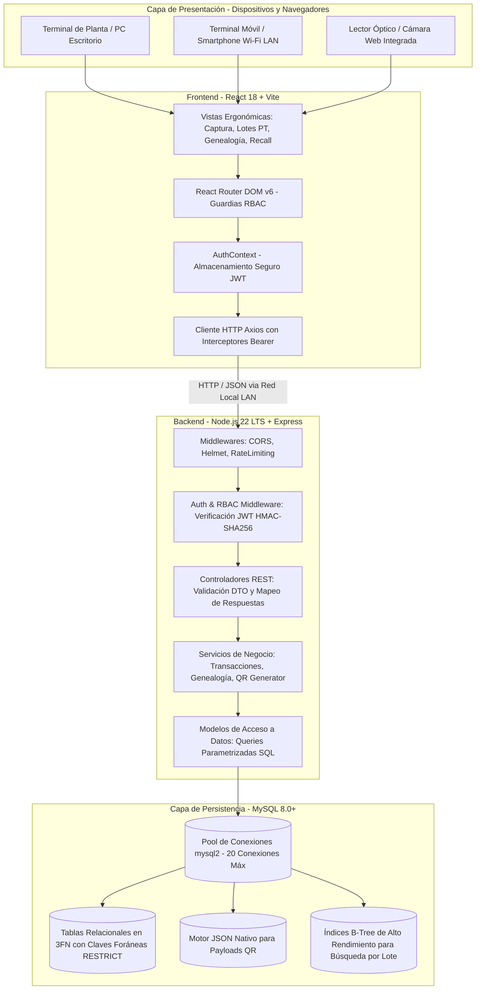
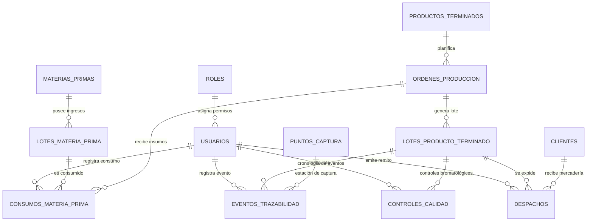

# DOCUMENTACIÓN TÉCNICA DE ARQUITECTURA Y SISTEMA — PP2

**Proyecto:** TrackFinal — Sistema de Trazabilidad y Seguimiento de Producto Terminado  
**KIT 4.0:** AVZ-03 (Trazabilidad de Lote/Unidad — Genealogía Avanzada)  
**Empresa Piloto:** Lácteos San Antonio S.A.  
**Estudiante:** Joaquín Nicolás Cuello  
**Carrera:** Tecnicatura Superior en Desarrollo de Software (3.º Año)  
**Cátedra:** Práctica Profesionalizante II (PP2)  
**Fecha:** Octubre 2026 (Semana 9)  
**Versión de la Entrega:** 1.0.0 (Code Freeze)  

---

## 1. Resumen del Sistema y Enfoque Industria 4.0

### 1.1 Problemática Industrial en la PyME Láctea
En el sector agroalimentario lácteo tradicional, el control de la producción y la expedición suele gestionarse mediante planillas de registro manual en papel, fichas de termoformado y hojas de cálculo dispersas. Cuando se presenta una contingencia bromatológica (por ejemplo, detección tardía de acidez elevada, carga microbiana fuera de norma o presencia de inhibidores/antibióticos en leche cruda) o un reclamo comercial de un cliente mayorista, la reconstrucción histórica del lote de producto terminado demanda entre 48 y 96 horas. En dicho lapso, la empresa desconoce qué clientes recibieron las hormas de queso o botellas de yogur afectadas, impidiendo aplicar un retiro preventivo (*Recall*) inmediato y exponiéndose a severas sanciones del Código Alimentario Argentino (CAA) y del SENASA.

### 1.2 Propuesta de Solución: TrackFinal (KIT AVZ-03)
**TrackFinal** es una plataforma web modular concebida bajo el paradigma de **Industria 4.0** que digitaliza de punta a punta la cadena de custodia del producto terminado. Sus capacidades clave son:
- **Digitalización en Planta:** Sustitución de planillas físicas por terminales de captura asistida en pantalla táctil en los 6 puntos críticos del flujo productivo.
- **Identificación Unívoca y Marcado QR:** Emisión inmediata de rótulos con código QR serializado que encapsula el payload criptográfico y técnico del lote en formato JSON estructurado.
- **Transaccionalidad ACID Robusta:** Gestión atómica de consumos de materia prima y bajas de inventario, imposibilitando la duplicación de códigos o descuadres de stock.
- **Motor de Genealogía Bidireccional:**
  * **Hacia Atrás (Backward):** Permite pasar del código QR de una horma o pallet al tambo proveedor de leche cruda, lote de fermento y parámetros analíticos de calidad en **menos de 2 segundos**.
  * **Hacia Adelante (Forward / Recall):** Ante un lote de materia prima sospechoso, identifica de forma instantánea todos los lotes de producto terminado elaborados, su ubicación actual en cámara de frío y el listado de clientes que recibieron despacho con su respectivo remito.
- **Protocolo de Recall de Emergencia:** Bloqueo preventivo masivo de lotes en base de datos con un solo clic, inhabilitando su expedición física.

---

## 2. Arquitectura Tecnológica en Capas

El sistema implementa una **Arquitectura en Capas Desacopladas (Layered Architecture)** con separación estricta de responsabilidades (*Separation of Concerns*), garantizando alta cohesión, bajo acoplamiento y facilidad para realizar pruebas automáticas e integración continua.



### Componentes de la Pila Tecnológica:
1. **Frontend (React 18 + Vite + Tailwind CSS):** Single Page Application (SPA) optimizada para tiempos de carga ultrarrápidos ($< 1\text{ s}$) y botones de gran tamaño diseñados para operarios con guantes en terminales táctiles de planta.
2. **Backend (Node.js 22 LTS + Express 4.21):** Servidor HTTP no bloqueante y asíncrono con arquitectura MVC orientada a servicios.
3. **Persistencia (MySQL 8.0 / MariaDB 10.5+):** Motor relacional InnoDB configurado con codificación `utf8mb4_unicode_ci`, transacciones atómicas `withTransaction` y almacenamiento nativo de campos de tipo `JSON`.
4. **Infraestructura de Red (Red Local LAN):** El servidor Express y el cliente Vite admiten enlace a la interfaz de red `0.0.0.0`, lo que habilita a cualquier terminal móvil o tablet industrial conectada al Wi-Fi de planta acceder al sistema sin requerir salida a internet.

---

## 3. Diccionario de Datos y Modelo Relacional (3FN)

El modelo de datos fue diseñado bajo la **Tercera Forma Normal (3FN)** con integridad referencial estricta (`ON UPDATE CASCADE ON DELETE RESTRICT`) para asegurar que la historia productiva no pueda ser alterada ni eliminada accidentalmente.



### Especificación de Tablas Principales:

#### 3.1 `roles`
*Descripción:* Perfiles de autorización granular para el control de acceso del sistema (RBAC).
* **`id`** (`INT`, PK, Auto-increment)
* **`nombre`** (`VARCHAR(50)`, NOT NULL, UNIQUE): Nombre del rol (`ADMIN`, `SUPERVISOR`, `OPERARIO`, `AUDITOR`).
* **`descripcion`** (`TEXT`): Alcance y responsabilidades operativas.
* **`created_at`** (`DATETIME`, DEFAULT CURRENT_TIMESTAMP)

#### 3.2 `usuarios`
*Descripción:* Personal de planta y supervisores autorizados a interactuar con el sistema.
* **`id`** (`INT`, PK, Auto-increment)
* **`nombre`** (`VARCHAR(100)`, NOT NULL)
* **`apellido`** (`VARCHAR(100)`, NOT NULL)
* **`legajo`** (`VARCHAR(50)`, NOT NULL, UNIQUE): Identificador laboral (ej. `OPE-014`, `CAL-002`).
* **`email`** (`VARCHAR(150)`, NOT NULL, UNIQUE)
* **`password_hash`** (`VARCHAR(255)`, NOT NULL): Hash Bcrypt con factor de costo 10.
* **`rol_id`** (`INT`, FK -> `roles.id`, RESTRICT)
* **`activo`** (`BOOLEAN`, DEFAULT TRUE)
* **`created_at`** (`DATETIME`, DEFAULT CURRENT_TIMESTAMP)

#### 3.3 `materias_primas`
*Descripción:* Catálogo maestro de insumos agropecuarios e ingredientes lácteos.
* **`id`** (`INT`, PK, Auto-increment)
* **`codigo_sku`** (`VARCHAR(50)`, NOT NULL, UNIQUE): Código maestro (ej. `MP-LECHE-01`).
* **`nombre`** (`VARCHAR(150)`, NOT NULL)
* **`descripcion`** (`TEXT`)
* **`unidad_medida`** (`VARCHAR(20)`, NOT NULL): `Litros`, `Kg`, `Gramos`, `Mililitros`.

#### 3.4 `lotes_materia_prima`
*Descripción:* Partidas de insumos ingresadas a fábrica con control de tambo de origen y stock.
* **`id`** (`INT`, PK, Auto-increment)
* **`materia_prima_id`** (`INT`, FK -> `materias_primas.id`, RESTRICT)
* **`codigo_lote_mp`** (`VARCHAR(100)`, NOT NULL, UNIQUE): Ej. `LMP-20260901-01`.
* **`proveedor`** (`VARCHAR(150)`, NOT NULL): Razón social del tambo o laboratorio de fermentos.
* **`fecha_recepcion`** (`DATE`, NOT NULL)
* **`fecha_vencimiento`** (`DATE`, NOT NULL)
* **`cantidad_inicial`** (`DECIMAL(10,2)`, NOT NULL)
* **`cantidad_actual`** (`DECIMAL(10,2)`, NOT NULL): Saldo en stock disponible.
* **`estado`** (`ENUM('DISPONIBLE', 'AGOTADO', 'RECHAZADO', 'CUARENTENA')`, DEFAULT 'DISPONIBLE')

#### 3.5 `productos_terminados`
*Descripción:* Catálogo de productos terminados aptos para consumo comercial.
* **`id`** (`INT`, PK, Auto-increment)
* **`codigo_sku`** (`VARCHAR(50)`, NOT NULL, UNIQUE): Ej. `PT-QCR-01`.
* **`nombre`** (`VARCHAR(150)`, NOT NULL)
* **`unidad_medida`** (`VARCHAR(20)`, NOT NULL): `Horma`, `Barra`, `Botella 1L`, `Pote 400g`.
* **`dias_vida_util`** (`INT`, NOT NULL): Días para cálculo automático de caducidad.
* **`temperatura_conservacion`** (`VARCHAR(50)`, NOT NULL): Rango térmico obligatorio.

#### 3.6 `ordenes_produccion`
*Descripción:* Órdenes de fabricación que agrupan los consumos de insumos y el lote derivado.
* **`id`** (`INT`, PK, Auto-increment)
* **`numero_op`** (`VARCHAR(50)`, NOT NULL, UNIQUE): Ej. `OP-2026-001`.
* **`producto_terminado_id`** (`INT`, FK -> `productos_terminados.id`, RESTRICT)
* **`cantidad_planificada`** (`DECIMAL(10,2)`, NOT NULL)
* **`fecha_inicio`** (`DATETIME`, DEFAULT CURRENT_TIMESTAMP)
* **`fecha_fin`** (`DATETIME`, NULL)
* **`linea_produccion`** (`VARCHAR(100)`, NOT NULL)
* **`estado`** (`ENUM('CREADA', 'EN_PROCESO', 'FINALIZADA', 'CANCELADA')`, DEFAULT 'CREADA')

#### 3.7 `consumos_materia_prima`
*Descripción:* Registro transaccional del vínculo entre los lotes de insumos y la OP (nexo de genealogía hacia atrás).
* **`id`** (`INT`, PK, Auto-increment)
* **`orden_produccion_id`** (`INT`, FK -> `ordenes_produccion.id`, RESTRICT)
* **`lote_mp_id`** (`INT`, FK -> `lotes_materia_prima.id`, RESTRICT)
* **`cantidad_consumida`** (`DECIMAL(10,2)`, NOT NULL)
* **`timestamp_consumo`** (`DATETIME`, DEFAULT CURRENT_TIMESTAMP)
* **`operario_id`** (`INT`, FK -> `usuarios.id`, RESTRICT)

#### 3.8 `lotes_producto_terminado`
*Descripción:* Entidad nuclear del KIT AVZ-03 que representa el lote fabricado con identificación digital QR.
* **`id`** (`INT`, PK, Auto-increment)
* **`orden_produccion_id`** (`INT`, FK -> `ordenes_produccion.id`, RESTRICT)
* **`codigo_lote_pt`** (`VARCHAR(100)`, NOT NULL, UNIQUE): Ej. `LPT-20260902-001`.
* **`cantidad_elaborada`** (`DECIMAL(10,2)`, NOT NULL)
* **`fecha_elaboracion`** (`DATE`, NOT NULL)
* **`fecha_vencimiento`** (`DATE`, NOT NULL): Calculada automáticamente en backend.
* **`estado`** (`ENUM('EN_PROCESO', 'CUARENTENA', 'APROBADO', 'RECHAZADO', 'DESPACHADO', 'BLOQUEADO')`, DEFAULT 'EN_PROCESO')
* **`codigo_qr_payload`** (`JSON`, NOT NULL): Payload estructurado embebido en el QR.
* **`ubicacion_deposito`** (`VARCHAR(100)`): Cámara y estantería de guarda.

#### 3.9 `puntos_captura` y `eventos_trazabilidad`
*Descripción:* Registro inmutable de la cronología de eventos por los que transita el lote a lo largo de los 6 puntos de planta.
* **`puntos_captura`:** `id`, `codigo_punto` (`PC-REC`, `PC-ELAB`, `PC-ENV`, `PC-CAL`, `PC-CAM`, `PC-DES`), `nombre`, `descripcion`.
* **`eventos_trazabilidad`:** `id` (`BIGINT`), `lote_pt_id` (FK), `punto_captura_id` (FK), `usuario_id` (FK), `etapa_nombre`, `linea_equipo`, `timestamp_evento`, `observaciones`.

#### 3.10 `controles_calidad`
*Descripción:* Evaluaciones fisicoquímicas y bromatológicas para la liberación del lote.
* **`id`** (`INT`, PK, Auto-increment)
* **`lote_pt_id`** (`INT`, FK -> `lotes_producto_terminado.id`, RESTRICT)
* **`usuario_id`** (`INT`, FK -> `usuarios.id`, RESTRICT)
* **`parametro_1_nombre`** (`VARCHAR(100)`), **`parametro_1_valor`** (`VARCHAR(50)`)
* **`parametro_2_nombre`** (`VARCHAR(100)`), **`parametro_2_valor`** (`VARCHAR(50)`)
* **`resultado`** (`ENUM('CONFORME', 'NO_CONFORME')`, NOT NULL)
* **`observaciones`** (`TEXT`)

#### 3.11 `clientes` y `despachos`
*Descripción:* Registro de expedición física y salida comercial de lotes a clientes mayoristas.
* **`clientes`:** `id`, `cuit`, `razon_social`, `direccion`, `telefono`.
* **`despachos`:** `id`, `lote_pt_id` (FK), `cliente_id` (FK), `numero_remito` (`VARCHAR(50)`), `fecha_despacho`, `cantidad_despachada`, `usuario_id` (FK).

---

## 4. Catálogo de Contratos de la API REST

Todos los endpoints (con excepción del healthcheck y login) requieren la cabecera HTTP:
`Authorization: Bearer <TOKEN_JWT>`

### 4.1 Autenticación (`/api/v1/auth`)

#### `POST /api/v1/auth/login`
*Público.* Autentica a un usuario y genera su token de sesión.
* **Request Body:**
```json
{
  "email": "operario@lacteossanantonio.com",
  "password": "Operario123!"
}
```
* **Respuesta Exitosa (200 OK):**
```json
{
  "success": true,
  "data": {
    "token": "eyJhbGciOiJIUzI1NiIsInR5cCI6IkpXVCJ9...",
    "usuario": {
      "id": 3,
      "nombre": "Carlos",
      "apellido": "Gómez",
      "legajo": "OPE-014",
      "email": "operario@lacteossanantonio.com",
      "rol": "OPERARIO"
    }
  }
}
```
* **Errores Posibles:** `400 Bad Request` (campos faltantes), `401 Unauthorized` (credenciales incorrectas).

#### `GET /api/v1/auth/me`
*Protegido (Cualquier rol autenticado).* Retorna los datos del usuario en sesión.

---

### 4.2 Lotes de Producto Terminado (`/api/v1/lotes-pt`)

#### `GET /api/v1/lotes-pt`
*Protegido.* Lista los lotes elaborados. Soporta query params: `?estado=APROBADO&busqueda=Queso`.

#### `GET /api/v1/lotes-pt/:codigo`
*Protegido.* Retorna el detalle completo de un lote por su código alfanumérico.

#### `GET /api/v1/lotes-pt/:codigo/qr`
*Protegido.* Genera y devuelve la imagen del código QR en formato DataURL Base64 PNG para impresión o renderizado en pantalla.
* **Respuesta Exitosa (200 OK):**
```json
{
  "success": true,
  "data": {
    "codigo_lote": "LPT-20260902-001",
    "qr_image_data_url": "data:image/png;base64,iVBORw0KGgoAAAANSUhEUgAA...",
    "payload": {
      "app": "TrackFinal",
      "version": "1.0",
      "lote": "LPT-20260902-001",
      "sku": "PT-QCR-01"
    }
  }
}
```

#### `POST /api/v1/lotes-pt`
*Protegido (`OPERARIO`, `ADMIN`).* Alta atómica de un nuevo lote con cálculo de vencimiento y evento inicial.
* **Request Body:**
```json
{
  "orden_produccion_id": 1,
  "codigo_lote_pt": "LPT-20260915-004",
  "cantidad_elaborada": 200.0,
  "fecha_elaboracion": "2026-09-15",
  "ubicacion_deposito": "Cámara 1 - Rack B4"
}
```
* **Respuesta Exitosa (201 Created):**
```json
{
  "success": true,
  "message": "Lote de producto terminado generado con éxito",
  "data": {
    "id": 4,
    "codigo_lote_pt": "LPT-20260915-004",
    "fecha_vencimiento": "2026-11-14",
    "estado": "EN_PROCESO",
    "codigo_qr_payload": { ... },
    "evento_inicial": {
      "id": 14,
      "etapa_nombre": "Envasado y Generación QR"
    }
  }
}
```

#### `PATCH /api/v1/lotes-pt/:codigo/estado`
*Protegido (`SUPERVISOR`, `ADMIN`).* Cambia el estado del lote (`CUARENTENA`, `APROBADO`, `RECHAZADO`, `BLOQUEADO`).
* **Nota de Seguridad:** Si un `AUDITOR` u `OPERARIO` envía esta petición, el middleware RBAC devuelve `403 Forbidden`.

---

### 4.3 Motor de Trazabilidad y Recall (`/api/v1/trazabilidad`)

#### `GET /api/v1/trazabilidad/backward/:codigo`
*Protegido.* Reconstruye la genealogía hacia atrás desde el código del lote PT.
* **Respuesta Exitosa (200 OK):**
```json
{
  "success": true,
  "data": {
    "lote_pt": "LPT-20260902-001",
    "producto": "Queso Cremoso Tradicional San Antonio",
    "sku": "PT-QCR-01",
    "orden_produccion": "OP-2026-001",
    "fecha_elaboracion": "2026-09-02",
    "fecha_vencimiento": "2026-11-01",
    "estado": "APROBADO",
    "materias_primas_consumidas": [
      {
        "materia_prima": "Leche Cruda Entera de Tambo",
        "codigo_lote_mp": "LMP-20260901-01",
        "proveedor": "Tambo Las Acacias (Ruta 205 Km 88)",
        "cantidad_consumida": "7500.00",
        "unidad_medida": "Litros"
      }
    ],
    "historial_eventos": [ ... ],
    "controles_calidad": [ ... ]
  }
}
```

#### `GET /api/v1/trazabilidad/forward/:codigo`
*Protegido.* Reconstruye la genealogía hacia adelante desde el código de lote de materia prima (`LMP-...`).
* **Respuesta Exitosa (200 OK):**
```json
{
  "success": true,
  "data": {
    "lote_mp": "LMP-20260901-01",
    "materia_prima": "Leche Cruda Entera de Tambo",
    "proveedor": "Tambo Las Acacias (Ruta 205 Km 88)",
    "productos_afectados": [
      {
        "lote_pt": "LPT-20260902-001",
        "producto": "Queso Cremoso Tradicional San Antonio",
        "estado": "APROBADO",
        "ubicacion_deposito": "Cámara 1 - Rack B3",
        "despachos": [
          {
            "remito": "R-0001-000089",
            "cliente": "Distribuidora Láctea Centro S.A.",
            "cuit": "30-71122334-9",
            "cantidad": "80.00",
            "fecha": "2026-09-04 10:15:00"
          }
        ]
      }
    ],
    "total_clientes_notificar": 1
  }
}
```

#### `POST /api/v1/trazabilidad/recall/bloqueo-preventivo`
*Protegido (`SUPERVISOR`, `ADMIN`).* Bloquea masivamente todos los lotes de PT derivados de una MP en cuarentena.

---

### 4.4 Expedición y Despachos (`/api/v1/despachos`)

#### `GET /api/v1/despachos/clientes`
*Protegido.* Retorna el catálogo de clientes mayoristas.

#### `POST /api/v1/despachos`
*Protegido (`SUPERVISOR`, `ADMIN`).* Registra la salida física de un lote hacia un cliente con remito oficial.
* **Request Body:**
```json
{
  "lote_pt_id": 1,
  "cliente_id": 1,
  "numero_remito": "R-0001-000095",
  "cantidad_despachada": 50.0
}
```

---

## 5. Guía Paso a Paso de Despliegue Local

### 5.1 Requisitos Previos del Entorno
* **Node.js:** Versión $\ge 18.0.0$ LTS (verificado en Node.js v22).
* **NPM:** Versión $\ge 9.0.0$.
* **Motor MySQL:** MySQL Server 8.0+ o MariaDB 10.5+ activo en el puerto `3306`.
* **Navegador Web:** Chrome, Edge o Firefox moderno con soporte para WebRTC (cámara para QR).

### 5.2 Estructura del Archivo de Entorno (`backend/.env`)
Crear o verificar el archivo `backend/.env` con los siguientes parámetros:
```env
# Puerto del servidor API REST
PORT=3000
NODE_ENV=development

# Conexión a Base de Datos MySQL
DB_HOST=localhost
DB_PORT=3306
DB_USER=root
DB_PASSWORD=
DB_NAME=trackfinal_db

# Clave secreta y vigencia del JWT
JWT_SECRET=trackfinal_jwt_secret_key_lacteos_san_antonio_2026_super_secure
JWT_EXPIRES_IN=8h
```

### 5.3 Inicialización de la Base de Datos
Abrir una terminal MySQL o cliente gráfico (MySQL Workbench / DBeaver / phpMyAdmin) y ejecutar los scripts SQL en el siguiente orden secuencial:
```bash
# 1. Creación de la estructura de tablas e índices
mysql -u root -p < database/schema_mysql.sql

# 2. Inserción de catálogo maestro, usuarios y dataset de prueba
mysql -u root -p < database/seeds_mysql.sql
```

### 5.4 Instalación de Dependencias
Ejecutar la instalación en el backend y en el frontend:
```bash
# En el directorio backend
cd backend
npm install

# En el directorio frontend
cd ../frontend
npm install
```

### 5.5 Puesta en Marcha del Sistema

#### Opción A: Script Automatizado para Windows
Hacer doble clic sobre el script de inicio ubicado en la raíz del proyecto:
```cmd
iniciar-proyecto.bat
```
Este script levantará automáticamente dos consolas:
- Consola 1: Backend en `http://localhost:3000`
- Consola 2: Frontend en `http://localhost:5173`

#### Opción B: Arranque Manual en Terminales Separadas
```bash
# Terminal 1 - Backend:
cd backend
npm start

# Terminal 2 - Frontend:
cd frontend
npm run dev
```

### 5.6 Despliegue y Acceso en Red Local LAN (Terminales Móviles de Planta)
Para acceder desde un teléfono celular o tablet conectada a la misma red Wi-Fi de planta:
1. Averiguar la dirección IP local de la computadora servidora ejecutando `ipconfig` en Windows (ejemplo: `192.168.1.45`).
2. Abrir en el navegador del dispositivo móvil:
   `http://192.168.1.45:5173`
3. Iniciar sesión con cualquiera de las cuentas de prueba disponibles.

---

## 6. Credenciales de Acceso de Prueba (Seeds)

| Perfil / Rol | Correo Electrónico | Contraseña | Legajo | Alcance Operativo |
| :--- | :--- | :---: | :---: | :--- |
| **ADMIN** | `admin@lacteossanantonio.com` | `Admin123!` | ADM-001 | Acceso irrestricto, configuración, usuarios y auditoría. |
| **SUPERVISOR** | `despacho@lacteossanantonio.com` | `Despacho123!` | DES-005 | Aprobación de estados, expedición, remitos y bloqueo de recall. |
| **OPERARIO** | `operario@lacteossanantonio.com` | `Operario123!` | OPE-014 | Captura en 6 puntos, consumo de MP, alta de lotes y rótulos QR. |
| **AUDITOR** | `calidad@lacteossanantonio.com` | `Calidad123!` | CAL-002 | **Veedor estricto:** Inspección visual, escaneo QR y recall. Sin mutaciones. |
