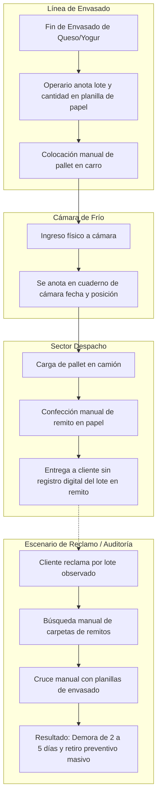
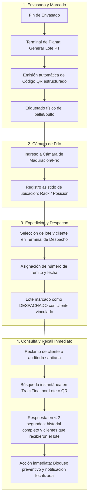

# ESPECIFICACIÓN DE REQUERIMIENTOS Y ANÁLISIS — PP2 | INDUSTRIA 4.0

**Proyecto:** TrackFinal — Seguimiento de Producto Terminado  
**KIT:** AVZ-03 (Trazabilidad de Lote/Unidad)  
**Estudiante:** Joaquín Nicolás Cuello  
**Fecha de Entrega:** 21/08/2026 (Semana 2) — Regularizado el 04/09/2026  
**Estado:** EVIDENCIADO  

---

## 1. Diagramas de Proceso: AS-IS vs TO-BE

### 1.1 Proceso Actual (AS-IS): Registro Manual en Papel y Excel Desconectado

En la situación inicial de la empresa láctea, los registros se generan en papel en la línea, luego se archivan o transcriben con demoras, y no existe un identificador unívoco y escaneable que conecte el producto con el despacho al cliente.



---

### 1.2 Proceso Propuesto 4.0 (TO-BE): Sistema Digital Centralizado con Códigos QR

Con **TrackFinal**, cada lote de producto terminado nace con una identidad digital y un código QR estructurado. Cada cambio de estado y movimiento de despacho se registra de inmediato.



---

## 2. Especificación de Requisitos del Sistema

### 2.1 Requisitos Funcionales (RF)

| ID | Nombre | Descripción | Prioridad |
| :---: | :--- | :--- | :---: |
| **RF01** | Autenticación y Perfiles (RBAC) | El sistema debe autenticar usuarios mediante credenciales y asignar permisos basados en 3 roles: *Administrador, Operario de Planta/Cámara, Encargado de Despacho*. | Alta (MVP) |
| **RF02** | Catálogo de Productos Lácteos | Permitir el alta, listado y edición de productos terminados (SKU, nombre, tipo: queso/yogur, vida útil en días, temperatura recomendada). | Alta (MVP) |
| **RF03** | Generación de Lote PT con QR | Al registrar el envasado, el sistema debe generar el código de lote según convención estándar (`LPT-YYYYMMDD-XXX`), calcular su vencimiento y generar su código QR estructurado. | Alta (MVP) |
| **RF04** | Registro Asistido en Cámara de Frío | Registrar el ingreso físico del lote a la cámara de frío con fecha, hora, operario y posición de estiba asignada. | Alta (MVP) |
| **RF05** | Gestión de Despacho a Clientes | El Encargado de Despacho debe registrar la expedición asociando el lote PT a un cliente, fecha de entrega y número de remito de transporte. | Alta (MVP) |
| **RF06** | Trazabilidad Hacia Atrás (Backward) | A partir del código de lote o QR, consultar al instante: datos del producto, fecha de elaboración, fecha de vencimiento, lote de materia prima asociada y fecha de ingreso a cámara. | Alta (MVP) |
| **RF07** | Trazabilidad Hacia Adelante (Recall) | A partir de un lote de producto terminado sospechoso o una materia prima observada, listar todos los clientes que recibieron mercadería asociada para actuar inmediatamente. | Alta (MVP) |
| **RF08** | Bloqueo Preventivo de Lote | Permitir cambiar el estado de un lote a `CUARENTENA` o `BLOQUEADO` para impedir que se despache por error. | Alta (MVP) |
| **RF09** | Gestión de Clientes | Administrar el padrón de clientes distribuidores, supermercados y mayoristas habilitados para despachos. | Media (MVP) |

---

### 2.2 Requisitos No Funcionales (RNF)

| ID | Nombre | Criterio de Medición |
| :---: | :--- | :--- |
| **RNF01** | **Tiempo de Respuesta (Rendimiento)** | Las consultas de trazabilidad de lote y listas de despacho deben devolver resultados en menos de **2 segundos**. |
| **RNF02** | **Usabilidad de Planta (UX)** | Interfaces con botones grandes (mínimo $44 \times 44\text{ px}$), etiquetas de alto contraste y flujos asistidos de máximo 3 clics para operarios. |
| **RNF03** | **Seguridad e Inmutabilidad** | Contraseñas cifradas con algoritmo `bcrypt` ($\ge 10\text{ salt rounds}$), sesiones mediante JWT con tiempo de expiración y registro inmutable de auditoría (usuario y timestamp en cada movimiento). |
| **RNF04** | **Disponibilidad y Multiplataforma** | Sistema web accesible desde navegadores estándar (Chrome, Edge, Firefox) operable tanto en terminales fijas como en tablets de planta. |

---

## 3. Casos de Uso e Historias de Usuario

### Historia de Usuario 1: Registro de Envasado y Generación de Lote PT
* **Como** Operario de Producción,
* **Quiero** registrar el fin de la elaboración de un lote de yogures o quesos y generar su código QR,
* **Para** identificar inequívocamente los pallets antes de enviarlos a la cámara de frío.
* **Criterio de Aceptación (Gherkin):**
  ```gherkin
  Given que el operario inició sesión con rol "OPERARIO"
  When selecciona el producto "Queso Cremoso 4kg" e ingresa la cantidad de 200 unidades
  Then el sistema genera el lote "LPT-20260904-001"
  And calcula la fecha de vencimiento en 60 días
  And genera un código QR descargable con el identificador del lote
  And coloca el estado inicial del lote en "EN_PROCESO".
  ```

### Historia de Usuario 2: Registro de Despacho a Cliente
* **Como** Encargado de Despacho,
* **Quiero** registrar la salida de un lote indicando el cliente y el número de remito,
* **Para** tener el registro exacto de qué mercadería salió y quién la recibió.
* **Criterio de Aceptación (Gherkin):**
  ```gherkin
  Given que el lote "LPT-20260904-001" está en cámara en estado "APROBADO"
  When el Encargado de Despacho selecciona el cliente "Supermercados Norte" e ingresa el remito "R-0001-000458"
  Then el sistema vincula el despacho al lote
  And actualiza el estado del lote a "DESPACHADO"
  And registra el timestamp y el legajo del usuario responsable.
  ```

### Historia de Usuario 3: Consulta Inmediata de Trazabilidad ante Reclamo
* **Como** Encargado de Logística / Supervisor,
* **Quiero** buscar un lote por su código o QR ante el reclamo de un cliente,
* **Para** saber en menos de 5 segundos la historia completa del producto y qué otros clientes tienen ese mismo lote.
* **Criterio de Aceptación (Gherkin):**
  ```gherkin
  Given que se reporta un problema con el lote "LPT-20260904-001"
  When el usuario ingresa el código de lote en el buscador de TrackFinal
  Then el sistema despliega la ficha completa con fecha de envasado, cámara, controles y listado de remitos/clientes
  And ofrece un botón de "Bloqueo Preventivo" para frenar unidades remanentes.
  ```

---

## 4. Matriz de Trazabilidad de Requisitos

Garantiza la coherencia exigida por el tutor:
$$\text{Problema} \longrightarrow \text{Objetivo} \longrightarrow \text{Requisito} \longrightarrow \text{Caso de Uso} \longrightarrow \text{Tabla BD}$$

| Problema Concreto | Objetivo SMART | Requisito Funcional | Caso de Uso | Entidad / Tabla BD |
| :--- | :--- | :--- | :--- | :--- |
| Pérdida de tiempo en identificar lotes entregados a clientes | Reducir búsqueda a $< 5\text{ seg}$ | **RF05** (Registro Despacho) | HU02 (Despacho) | `despachos`, `lotes_producto_terminado` |
| Falta de vínculo entre envasado y cámara de frío | Identificación única por QR | **RF03** (Lote PT + QR), **RF04** (Cámara) | HU01 (Envasado) | `lotes_producto_terminado`, `movimientos_camara` |
| Retiros masivos por no poder acotar productos afectados | Trazabilidad bidireccional y recall | **RF06** (Backward), **RF07** (Recall) | HU03 (Consulta) | `eventos_trazabilidad`, `lotes_materia_prima` |
| Registros manuales en papel sin auditoría | Inmutabilidad de roles y eventos | **RF01** (Seguridad RBAC) | Login / Seguridad | `usuarios`, `roles` |

---

## 5. Wireframes de Interfaces Principales (Diseño Conceptual)

### 5.1 Terminal de Captura Asistida en Planta (Operario)
```
+--------------------------------------------------------------------+
| TrackFinal | Planta Láctea                Usuario: Operario (Línea)|
+--------------------------------------------------------------------+
|  [ 1. NUEVO ENVASADO ]     [ 2. INGRESO CÁMARA ]   [ 3. CONSULTA ] |
+--------------------------------------------------------------------+
| NUEVO LOTE DE PRODUCTO TERMINADO                                   |
|                                                                    |
| Producto:       [ Seleccionar: Yogur Bebible Frutilla 1L       v ] |
| Cantidad (u):   [ 500              ]                               |
| Lote MP Leche:  [ MP-LEC-2026-0819 (Tambo San José)            v ] |
| Observaciones:  [ Producción Turno Mañana Línea 2                ] |
|                                                                    |
|           [ GENERAR LOTE Y EMITIR CÓDIGO QR ]                      |
|                                                                    |
| Vista Previa Etiqueta Generada:                                    |
| +----------------------------------------------------------------+ |
| | [ CÓDIGO QR ]  Lote: LPT-20260904-001   Venc: 04/10/2026       | |
| | [           ]  Yogur Bebible Frutilla 1L  Cant: 500u           | |
| +----------------------------------------------------------------+ |
+--------------------------------------------------------------------+
```

### 5.2 Terminal de Despacho a Clientes (Logística)
```
+--------------------------------------------------------------------+
| TrackFinal | Despacho y Expedición           Usuario: Logística    |
+--------------------------------------------------------------------+
| SELECCIÓN DE LOTE A DESPACHAR:                                     |
| Lote PT:        [ LPT-20260904-001 (Yogur Frutilla - 500u disp.) v ]|
|                                                                    |
| DATOS DE EXPEDICIÓN:                                               |
| Cliente:        [ Supermercados Norte S.A.                      v ]|
| Número Remito:  [ R-0001-000458    ]   Fecha: [ 04/09/2026       ] |
| Cantidad:       [ 300              ] unidades                      |
|                                                                    |
|                    [ CONFIRMAR Y REGISTRAR DESPACHO ]              |
+--------------------------------------------------------------------+
| ÚLTIMOS DESPACHOS REGISTRADOS:                                     |
| Remito        | Fecha      | Cliente             | Lote     | Cant |
| R-0001-000458 | 04/09/2026 | Supermercados Norte | LPT-001  | 300u |
+--------------------------------------------------------------------+
```

### 5.3 Monitor de Trazabilidad y Consulta Rápida ante Reclamo
```
+--------------------------------------------------------------------+
| TrackFinal | Trazabilidad y Recall            Usuario: Supervisor  |
+--------------------------------------------------------------------+
| Ingrese Código de Lote PT: [ LPT-20260904-001        ]  [ BUSCAR ]  |
+--------------------------------------------------------------------+
| RESULTADO DE TRAZABILIDAD (Encontrado en 0.45 segundos)            |
| Producto: Yogur Bebible Frutilla 1L  | Estado: PARCIALMENTE DESP.   |
| Elaboración: 04/09/2026              | Vencimiento: 04/10/2026      |
| Materia Prima: Lote Leche MP-LEC-0819 (Tambo San José)             |
| Cámara: Cámara 1 - Rack B3 (200 unidades en stock)                 |
+--------------------------------------------------------------------+
| CLIENTES QUE RECIBIERON ESTE LOTE (EXPEDICIÓN):                    |
| - Supermercados Norte (Remito R-0001-000458) -> 300 unidades        |
|                                                                    |
| [ ⚠️ APLICAR BLOQUEO PREVENTIVO ]    [ EXPORTAR REPORTE PDF ]      |
+--------------------------------------------------------------------+
```
